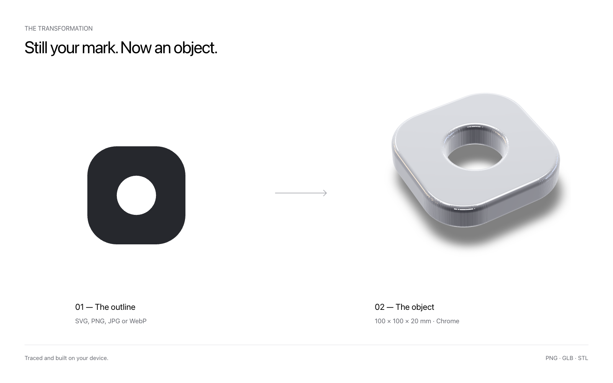

# Vitrum

[Try it](https://vitrum-3d.vercel.app)

Vitrum turns a flat icon, logo or wordmark into a true-to-size 3D object in glass, metal or colour. It runs entirely in the browser. Your image never leaves the device.

## Features

- Drop in an SVG, PNG, JPG or WebP
- Glass, metal, ceramic and colour finishes
- Extrude, stack, inflate or relief
- Built in millimetres
- Export to PNG, GLB or STL

## How it works

The image is drawn to a canvas, masked and traced into an outline in a Web Worker. The outline is built into a solid, given a material and lit on a studio stage. No server, no external API.

## Development

```bash
pnpm install
pnpm dev        # http://localhost:3000
pnpm test       # unit tests
pnpm test:e2e   # end-to-end tests
pnpm generate   # static build
```

Built with Nuxt, Three.js and Tailwind CSS.

## Contributing

Issues and pull requests are welcome. Run `pnpm check` before opening a pull request.

## License

MIT
